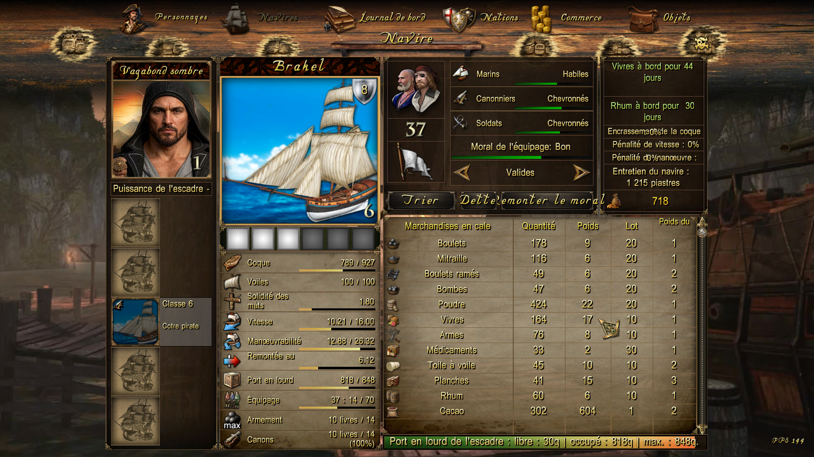

# Traduction-VF-Corsairs-Ship-Pack
Ceci est un projet de traduction en VF pour le jeu Corsairs Ship Pack. Qui dans ça version officiel n'est dispo qu'en Englais ou en Russe. Je tient à préciser que ce projet à été réalisé graçe a L'IA Claude par soucis d'honnêteté et de transparence.

VERSION FRANÇAISE DE CORSAIRS SHIP PACK
Prévue pour la version du jeu v2.4.8.0 (02.09.2026). Traduction du 19/11/2026.

INSTALLATION
1. Décompressez ce fichier .zip où vous voulez (par exemple sur le Bureau).
2. Double-cliquez sur INSTALLER_VF.bat, puis choisissez le dossier du jeu
   (celui qui contient engine.exe).
   Astuce : si vous décompressez le .zip directement dans le dossier du jeu,
   celui-ci est trouvé tout seul.
3. C'est tout : le jeu démarre en français.

Le programme d'installation :
- vérifie que les scripts du jeu correspondent à la version prévue ; sinon, il vous
  prévient avant de modifier quoi que ce soit ;
- sauvegarde chaque fichier remplacé dans FR_Traduction\backup\avant_installation ;
- utilise les voix anglaises pour la langue française (lien, sans copie) ;
- règle la langue du jeu sur le français.
Windows 10 ou 11 suffit, rien d'autre à installer.

CHANGER DE LANGUE
Dans le dossier du jeu : FR_Traduction\Langue_Francais.bat, Langue_Anglais.bat ou
Langue_Russe.bat.
Attention : les boutons RU/EN du lanceur réécrivent ce réglage ; relancez alors
Langue_Francais.bat.

DÉSINSTALLER
FR_Traduction\Desinstaller_VF.bat remet les fichiers d'origine et retire la version
française. Le dossier FR_Traduction peut ensuite être supprimé.

APRÈS UNE MISE À JOUR DU JEU
FR_Traduction\Regenerer_FR.bat reconstruit la version française à partir des nouveaux
fichiers anglais (Python 3 nécessaire). Les phrases nouvelles restent en anglais.
Le détail se trouve dans FR_Traduction\LISEZMOI.md.

  

